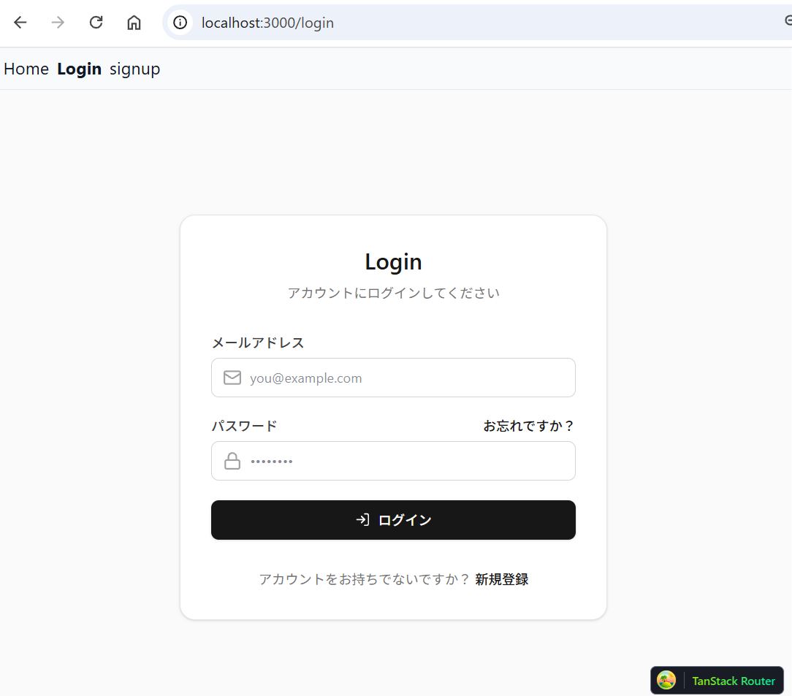
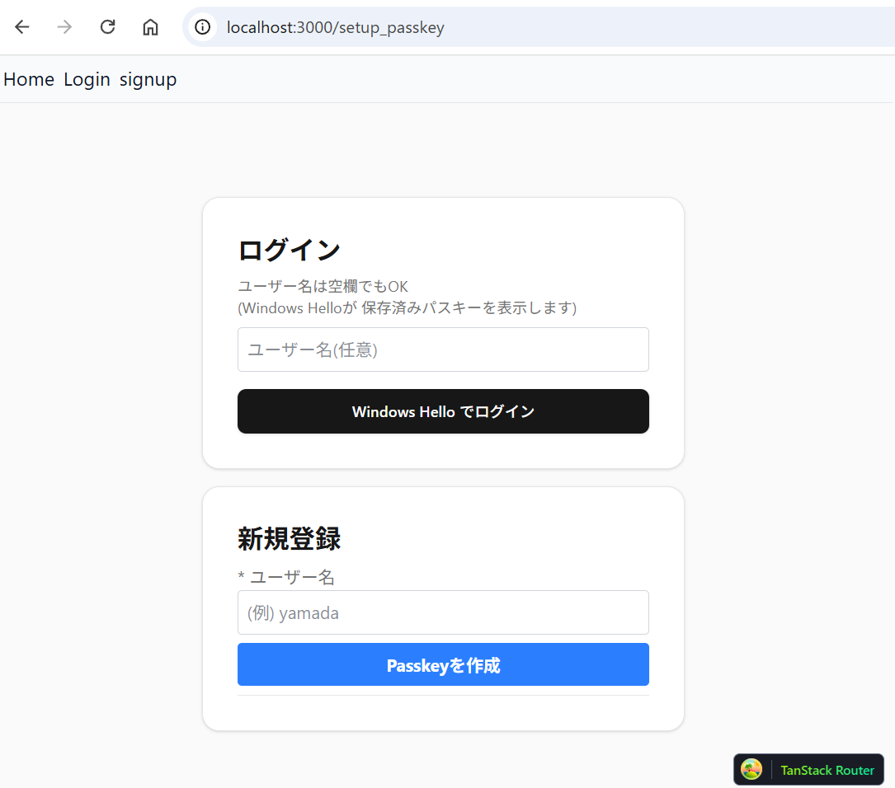

# passkey_3

 Version: 0.9.1

 Author  : 

 date    : 2026/11/07
 
 update  :

***
### Summary

TanStack Start , Passkey authrize 2FA Example

* windows11 , Windows hello
* SQLite DB
* node22
* Linux

***
***
### Images

* login



* Passkey　作成 , Windows hello ログイン


***

* .env
```
TOTP_ISSUER=DemoApp
PORT=3000
# NODE_ENV=production   (HTTPS 配下で secure cookie を有効化)
DB_PATH=./app.db
```

***
```
npm install
npm run dev                # http://localhost:3000
```

***
### version
* V_0_9_1: new

***
### blog

https://zenn.dev/knaka0209/scraps/303768b166942b

